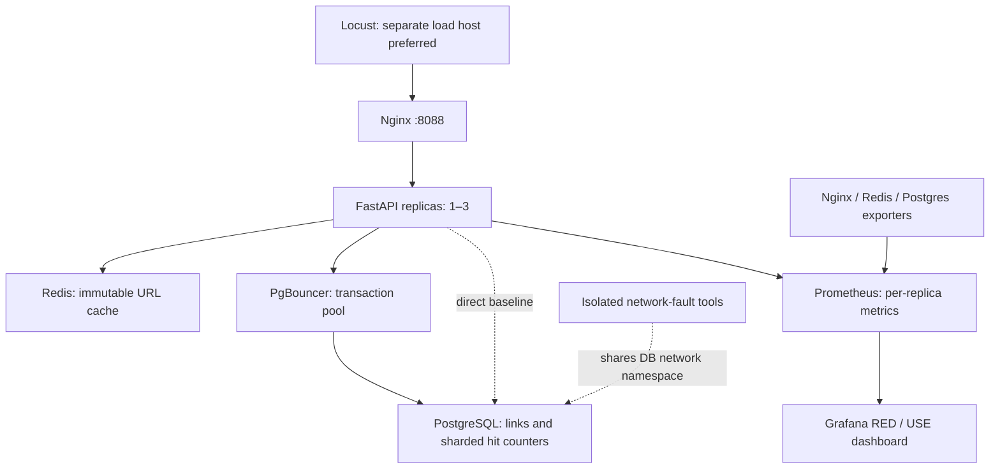

# Architecture and correctness

## Request paths

Creation uses a short random URL-safe code with a database primary key. A unique nullable idempotency key and SHA-256 of the normalized URL make concurrent retries atomic across workers and replicas. A code collision causes a retry; a reused key with a changed fingerprint returns 409. No URL is fetched by the service.

Resolution first looks up `link:<code>` in Redis. A miss reads PostgreSQL and sets a TTL. Disabled or failed Redis lookups fall back to the database. Redis operations have 50 ms connect/socket timeouts, no automatic retries, and a one-second worker-local cooldown after failure. A burst can still send concurrent cache-miss reads to the database; there is no distributed cache-fill lock. This is a measurable cache stampede tradeoff.

Every resolution commits a hit before returning. Hits use 64 `(code, bucket)` rows per link; `INSERT ... ON CONFLICT ... hits + 1` prevents lost updates. Stats sum all committed buckets in one query. Stats queries themselves do not increment hits. Counts survive Redis restarts and cache eviction. A disconnected client or proxy retry can cause a committed attempt without an acknowledged response, so counts represent committed resolution attempts, not unique people or exactly-once client receipt.

URLs are immutable. There is no post-update invalidation race or URL staleness claim in this API. Seed/reset operations clear both PostgreSQL data and Redis.

## Resource limits and failure behavior

The per-worker Psycopg async pool is bounded at 16 connections by default, with a one-second acquisition timeout and a bounded waiting queue. Pool health checks validate checked-out connections. PgBouncer allows at most 28 server connections for the database, including its reserve. Prepared statements are disabled for transaction-pool compatibility. The PostgreSQL app role is not a superuser; the observer role uses `pg_monitor`.

App requests have a five-second cancellation deadline in the same ASGI task. PostgreSQL has a four-second statement timeout. Operational database failures return 503 with `Retry-After`, rather than counting failed durable writes as successful resolutions. A client timing out after a committed creation should retry using the same idempotency key.

`/health/live` needs no dependency. `/health/ready` initiates database cancellation after one second and fails while the drain flag exists. Redis is an optional acceleration layer, so its outage is reported as degraded readiness with HTTP 200. Application startup requires the DB; an app cannot serve meaningful resolutions without durable storage.

Cancellation cleanup can extend response time when database packets are dropped. The pinned driver can spend five seconds sending cancellation and another five waiting for the interrupted query to finish. The blocked-port drill observed a client timeout before a gateway response. These cancellation deadlines do not guarantee an HTTP response within the same interval; inspect both app and Nginx timeouts. See the [Psycopg 3.3.6 cancellation implementation](https://github.com/psycopg/psycopg/blob/3.3.6/psycopg/psycopg/connection_async.py).

## Routing and graceful maintenance

Compose scales the `app` service to three containers. Nginx resolves its Docker DNS records at runtime and keeps upstream state in a shared zone. It passively avoids failed peers. GET requests may retry another peer on a connection error, timeout or gateway/dependency failure. Sent POST requests are not automatically retried; clients use idempotency keys. Passive failover does not promise that every in-flight request survives a crash.

Docker health checks establish startup ordering and expose health status; Nginx OSS does not read that state. Planned maintenance therefore uses `scripts/drain.py`:

1. Create the shared drain flag in the selected container, making all its workers fail readiness.
2. Replace the upstream with the remaining replica IPs and validate/reload Nginx.
3. Allow old Nginx workers to finish within their 20-second shutdown bound.
4. Stop the app with a 25-second graceful timeout, optionally restart it, and restore DNS routing.

Gunicorn allows 20 seconds for application shutdown and Compose allows 30 seconds before a forced kill. The drain script restores proxy configuration in `finally`; after a hard interruption, `docker compose restart nginx` re-renders the normal DNS upstream.

Nginx reload can close an idle client keepalive connection while a client attempts to reuse it. Local maintenance validation observed one such transport disconnect and no HTTP 5xx responses. Clients should retry safe reads and use the same idempotency key when retrying writes. Draining is not an exactly-once transport guarantee.

## Metrics and alerts

Application RED metrics exclude health checks and scrapes from request totals/latency. Route templates bound label cardinality; raw URL codes and idempotency keys never become labels. All requests receive a validated or generated request ID; Nginx creates and forwards a request ID, and logs upstream addresses, statuses and timings. App logs use the same ID and avoid logging URLs or idempotency keys.

Gunicorn workers share Prometheus counter/histogram files per container. Live gauges retire on worker exit. Prometheus discovers and scrapes every app IP, plus Nginx, Redis and PostgreSQL exporters. The dashboard shows service RED and dependency connection utilization, waiting requests, memory, blocked clients and errors. This is not a host CPU/IO profiler; use the recorded environment, Docker/host tools and load-generator CPU samples for that analysis.

Prometheus evaluates latency, errors, replica count, database connection utilization, pool waiting, Redis outage and database outage rules. These are visible in Prometheus's Alerts view; Grafana uses the provisioned datasource and panels. No external notification destination is configured. Short drills may end before a rule's `for` window elapses.
