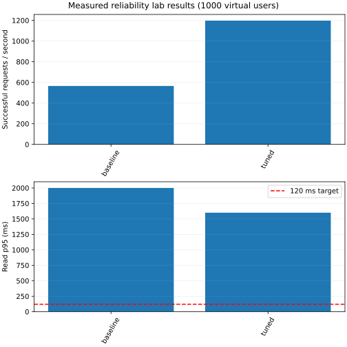

# Measured benchmark report

Medians of repeated runs; latency units are milliseconds. These are measured outcomes, not promises.

Warmup: 10.0 s after spawning; measurement: 30.0 s; client: FastHttpUser. One repetition is a smoke check, not a repeated study.

| Experiment | Repeats | Users | All RPS | Successful RPS | p50 | p95 | p99 | Read p95 | Errors | Cache hit | DB connections |
|---|---:|---:|---:|---:|---:|---:|---:|---:|---:|---:|---:|
| baseline | 3 | 1000 | 956.76 | 565.37 | 1000.00 | 2000.00 | 2600.00 | 2000.00 | 40.91% | n/a | 19.00 |
| tuned | 3 | 1000 | 1589.79 | 1197.58 | 410.00 | 1600.00 | 2000.00 | 1600.00 | 31.00% | n/a | 26.00 |

## Attribution

Each comparison below changes the versioned variable relative to its parent.

Overall baseline → tuned: successful throughput +111.82%; p95 reduction +20.00%. This combined comparison does not attribute causality to individual changes.

## Interpretation

- Virtual users, established TCP connections, and simultaneous in-flight requests are different quantities.
- Nginx socket samples are saved in each run. A user count alone does not prove 1,000 concurrent connections.
- Cache hit rate uses Prometheus counter deltas; scrape boundaries can differ by up to one scrape interval.
- Cache ratios from schema v1 are withheld because those snapshots did not preserve individual counter identities. Schema v2 rejects counter resets and replica churn.
- A short local smoke run cannot establish the proposal's target or a resume claim.
- Use three 120-second measurements after 30-second warmups on a separate load host; inspect CPU, errors, socket samples, and per-endpoint results.
- Missing dependency metrics are reported as n/a; they are never replaced with zero.
- All RPS includes failed requests. Throughput comparisons and charts use successful RPS; inspect latency alongside errors.

baseline: sampled established client connections min=1000, max=1012.
tuned: sampled established client connections min=1000, max=1001.

