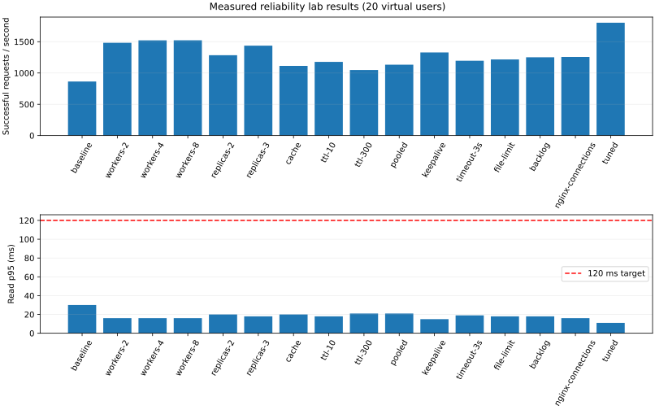

# Measured benchmark report

Medians of repeated runs; latency units are milliseconds. These are measured outcomes, not promises.

Warmup: 3.0 s after spawning; measurement: 10.0 s; client: FastHttpUser. One repetition is a smoke check, not a repeated study.

| Experiment | Repeats | Users | All RPS | Successful RPS | p50 | p95 | p99 | Read p95 | Errors | Cache hit | DB connections |
|---|---:|---:|---:|---:|---:|---:|---:|---:|---:|---:|---:|
| baseline | 1 | 20 | 864.04 | 864.04 | 12.00 | 30.00 | 70.00 | 30.00 | 0.00% | n/a | 11.50 |
| workers-2 | 1 | 20 | 1482.04 | 1482.04 | 6.00 | 16.00 | 28.00 | 16.00 | 0.00% | n/a | 16.00 |
| workers-4 | 1 | 20 | 1521.47 | 1521.47 | 6.00 | 16.00 | 30.00 | 16.00 | 0.00% | n/a | 40.00 |
| workers-8 | 1 | 20 | 1522.62 | 1522.62 | 6.00 | 16.00 | 29.00 | 16.00 | 0.00% | n/a | 51.50 |
| replicas-2 | 1 | 20 | 1284.14 | 1284.14 | 7.00 | 20.00 | 56.00 | 20.00 | 0.00% | n/a | 25.00 |
| replicas-3 | 1 | 20 | 1436.44 | 1436.44 | 6.00 | 18.00 | 36.00 | 18.00 | 0.00% | n/a | 27.50 |
| cache | 1 | 20 | 1113.45 | 1113.45 | 11.00 | 20.00 | 34.00 | 20.00 | 0.00% | n/a | 19.00 |
| ttl-10 | 1 | 20 | 1177.78 | 1177.78 | 10.00 | 18.00 | 29.00 | 18.00 | 0.00% | n/a | 19.00 |
| ttl-300 | 1 | 20 | 1047.81 | 1047.81 | 12.00 | 22.00 | 41.00 | 21.00 | 0.00% | n/a | 18.50 |
| pooled | 1 | 20 | 1132.37 | 1132.37 | 10.00 | 22.00 | 33.00 | 21.00 | 0.00% | n/a | 14.50 |
| keepalive | 1 | 20 | 1328.47 | 1328.47 | 8.00 | 15.00 | 27.00 | 15.00 | 0.00% | n/a | 16.50 |
| timeout-3s | 1 | 20 | 1195.25 | 1195.25 | 9.00 | 19.00 | 37.00 | 19.00 | 0.00% | n/a | 18.00 |
| file-limit | 1 | 20 | 1216.24 | 1216.24 | 9.00 | 19.00 | 36.00 | 18.00 | 0.00% | n/a | 18.00 |
| backlog | 1 | 20 | 1251.37 | 1251.37 | 9.00 | 19.00 | 30.00 | 18.00 | 0.00% | n/a | 18.00 |
| nginx-connections | 1 | 20 | 1255.86 | 1255.86 | 9.00 | 17.00 | 35.00 | 16.00 | 0.00% | n/a | 18.00 |
| tuned | 1 | 20 | 1803.03 | 1803.03 | 4.00 | 11.00 | 19.00 | 11.00 | 0.00% | n/a | 18.00 |

## Attribution

Each comparison below changes the versioned variable relative to its parent.

- baseline → workers-2 (workers): successful throughput +71.52%; p95 reduction +46.67%.
- workers-2 → workers-4 (workers): successful throughput +2.66%; p95 reduction +0.00%.
- workers-4 → workers-8 (workers): successful throughput +0.08%; p95 reduction +0.00%.
- baseline → replicas-2 (replicas): successful throughput +48.62%; p95 reduction +33.33%.
- replicas-2 → replicas-3 (replicas): successful throughput +11.86%; p95 reduction +10.00%.
- baseline → cache (cache enabled): successful throughput +28.87%; p95 reduction +33.33%.
- cache → ttl-10 (cache TTL): successful throughput +5.78%; p95 reduction +10.00%.
- cache → ttl-300 (cache TTL): successful throughput -5.90%; p95 reduction -10.00%.
- cache → pooled (database route): successful throughput +1.70%; p95 reduction -10.00%.
- pooled → keepalive (upstream keepalive): successful throughput +17.32%; p95 reduction +31.82%.
- keepalive → timeout-3s (proxy timeout): successful throughput -10.03%; p95 reduction -26.67%.
- keepalive → file-limit (file descriptors): successful throughput -8.45%; p95 reduction -26.67%.
- file-limit → backlog (listen backlog): successful throughput +2.89%; p95 reduction +0.00%.
- backlog → nginx-connections (Nginx connections): successful throughput +0.36%; p95 reduction +10.53%.
- nginx-connections → tuned (replicas): successful throughput +43.57%; p95 reduction +35.29%.

Overall baseline → tuned: successful throughput +108.67%; p95 reduction +63.33%. This combined comparison does not attribute causality to individual changes.

## Interpretation

- Virtual users, established TCP connections, and simultaneous in-flight requests are different quantities.
- Nginx socket samples are saved in each run. A user count alone does not prove 1,000 concurrent connections.
- Cache hit rate uses Prometheus counter deltas; scrape boundaries can differ by up to one scrape interval.
- Cache ratios from schema v1 are withheld because those snapshots did not preserve individual counter identities. Schema v2 rejects counter resets and replica churn.
- A short local smoke run cannot establish the proposal's target or a resume claim.
- Use three 120-second measurements after 30-second warmups on a separate load host; inspect CPU, errors, socket samples, and per-endpoint results.
- Missing dependency metrics are reported as n/a; they are never replaced with zero.
- All RPS includes failed requests. Throughput comparisons and charts use successful RPS; inspect latency alongside errors.

baseline: sampled established client connections min=20, max=20.
workers-2: sampled established client connections min=20, max=20.
workers-4: sampled established client connections min=20, max=20.
workers-8: sampled established client connections min=20, max=20.
replicas-2: sampled established client connections min=20, max=20.
replicas-3: sampled established client connections min=20, max=20.
cache: sampled established client connections min=20, max=20.
ttl-10: sampled established client connections min=20, max=20.
ttl-300: sampled established client connections min=20, max=20.
pooled: sampled established client connections min=20, max=20.
keepalive: sampled established client connections min=20, max=20.
timeout-3s: sampled established client connections min=20, max=20.
file-limit: sampled established client connections min=20, max=20.
backlog: sampled established client connections min=20, max=20.
nginx-connections: sampled established client connections min=20, max=20.
tuned: sampled established client connections min=20, max=20.

